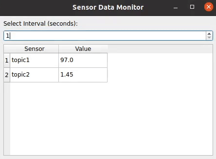
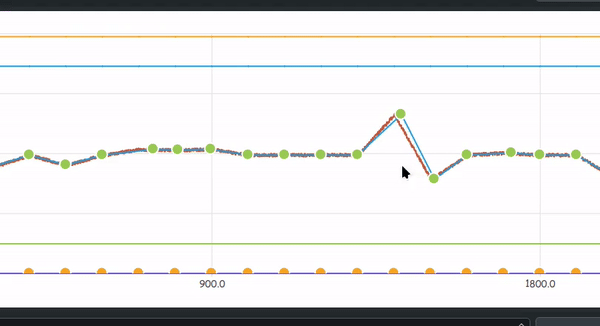
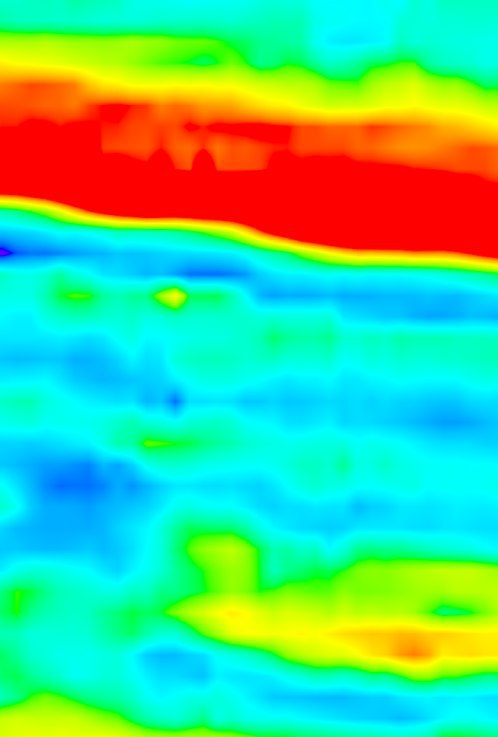
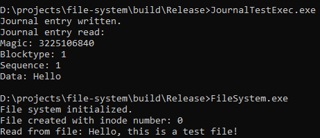
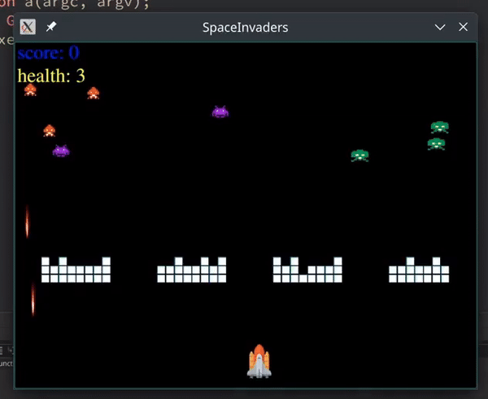
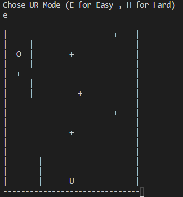

# Engineering Portfolio

> _Previously named `cpp_projects` — renamed to reflect the mix of C++, Python, and Qt work across this collection._

A curated collection of software projects spanning industrial communication (OPC UA, Modbus TCP), real-time data streaming, machine learning, systems programming, and game development. The work-related projects are included as **git submodules** (separate repositories), while the remaining projects live directly in this repository.

---

## Projects

### Submodules (separate repositories)

#### 1. Qt Modbus TCP Client
A Qt-based Modbus TCP client handling multiple devices, register batching, automatic reconnection, and real-time data processing for monitoring and charting.

- **Tech**: C++, Qt, CMake
- **Repo**: [Ali-Noghabi/ModbusQtClient](https://github.com/Ali-Noghabi/ModbusQtClient) → [`ModbusQtClient/`](ModbusQtClient/)
- [Read more](ModbusQtClient/README.md)

#### 2. OPC UA Logger
A Python application that subscribes to OPC UA tags and logs data changes to JSON/CSV. Supports all OPC UA security policies, certificate-based encryption, and offers both CLI and GUI versions.

- **Tech**: Python, OPC UA, cryptography
- **Repo**: [Ali-Noghabi/opcua-logger](https://github.com/Ali-Noghabi/opcua-logger) → [`opcua-logger/`](opcua-logger/)
- [Read more](opcua-logger/README.md)

#### 3. Modbus TCP Viewer
A Flask-based web app that reads Coils, Discrete Inputs, Holding Registers, and Input Registers from a Modbus TCP server and displays them in a web UI. Containerized with Docker and backed by a CI/CD pipeline.

- **Tech**: Python, Flask, Docker, GitHub Actions
- **Repo**: [Ali-Noghabi/modbus_tcp_viewer](https://github.com/Ali-Noghabi/modbus_tcp_viewer) → [`modbus_tcp_viewer/`](modbus_tcp_viewer/)
- [Read more](modbus_tcp_viewer/README.md)

---

### Real-time & Data Streaming

#### 4. OPC UA Data Streamer
Streams data from predefined topics to an OPC UA server for centralized processing, emphasizing high throughput and reliable data transfer.

- **Tech**: C++, Qt, OPC UA
- [Read more](opcua_datastreamer/README.md)



#### 5. UDP Data Generator
A real-time data generator with live chart visualization, built for testing and validating UDP-based data communication. Allows control of single and multiple data streams with real-time chart updates.

- **Tech**: C++, Qt
- [Read more](udp_datagenerator/README.md)



#### 6. Model Runner
A PySide6-based real-time data processing client that retrieves live data over REST/WebSockets, runs a customizable neural network model, and pushes results back to the server. Leverages `QObject` for high-performance data processing.

- **Tech**: Python, PySide6, REST, WebSockets, neural networks
- [Read more](model_runner/README.md)

---

### Compilers & Systems

#### 7. BMinor Compiler
A compiler for the BMinor language implemented in C, featuring extensive error handling, optimization passes, and intermediate code generation.

- **Tech**: C
- [Read more](BMinor-Compiler/README.md)

#### 8. Image Renderer
A graphics rendering engine that generates images from 3D models with customizable shaders, lighting effects, and textures.

- **Tech**: C++
- [Read more](image_renderer/README.md)



#### 9. File System
A simulation of an EXT4-like file system in C++, with inodes, block groups, and journaling for data consistency and integrity.

- **Tech**: C++
- [Read more](file-system/README.md)



#### 10. Semi Redis
A simplified Redis-like key-value store implemented in C++ over sockets, supporting basic store/retrieve/delete operations.

- **Tech**: C++, sockets
- [Read more](semi_redis/README.md)

<p align="center">
  
</p>

---

### Games & Widgets

#### 11. Space Invaders
A classic Space Invaders recreation using the Qt framework.

- **Tech**: C++, Qt
- [Read more](space_invaders/README.md)



#### 12. Packman
A clone of the classic Pac-Man game with obstacle creation, multiple levels, and power-ups, using SDL for graphics and input handling.

- **Tech**: C++, SDL
- [Read more](packman/README.md)



#### 13. Circular Loading
A lightweight circular loading animation built with Qt.

- **Tech**: C++, Qt
- [Read more](circular_loading/README.md)

---

## Repository Structure

```
engineering-portfolio/
├── .gitmodules                 # links the submodules
│
├── ModbusQtClient/             # submodule — Modbus TCP client
├── opcua-logger/               # submodule — OPC UA data logger
├── modbus_tcp_viewer/         # submodule — Modbus TCP web viewer
│
├── opcua_datastreamer/        # OPC UA data streamer
├── udp_datagenerator/          # UDP real-time data generator
├── model_runner/               # real-time ML inference client
│
├── BMinor-Compiler/           # compiler
├── image_renderer/            # graphics renderer
├── file-system/               # EXT4-like file system
├── semi_redis/                # Redis-like key-value store
├── space_invaders/            # game
├── packman/                   # game
└── circular_loading/          # Qt widget
```

---

## Cloning with Submodules

To clone this repository along with all linked submodules:

```bash
# Clone and initialize submodules in one step
git clone --recurse-submodules https://github.com/Ali-Noghabi/cpp_projects.git

# Or, if already cloned:
git submodule update --init --recursive
```

---

## Tech Stack Summary

| Domain              | Technologies                                    |
| ------------------- | ----------------------------------------------- |
| Industrial comms    | OPC UA, Modbus TCP, OPC UA security policies    |
| Languages           | C++, C, Python                                  |
| Frameworks          | Qt (Core, SerialBus), PySide6, Flask            |
| ML                  | customizable neural network models             |
| Real-time           | REST APIs, WebSockets, UDP                      |
| DevOps              | Docker, Docker Compose, GitHub Actions CI/CD   |
| Build               | CMake, C++17                                    |
